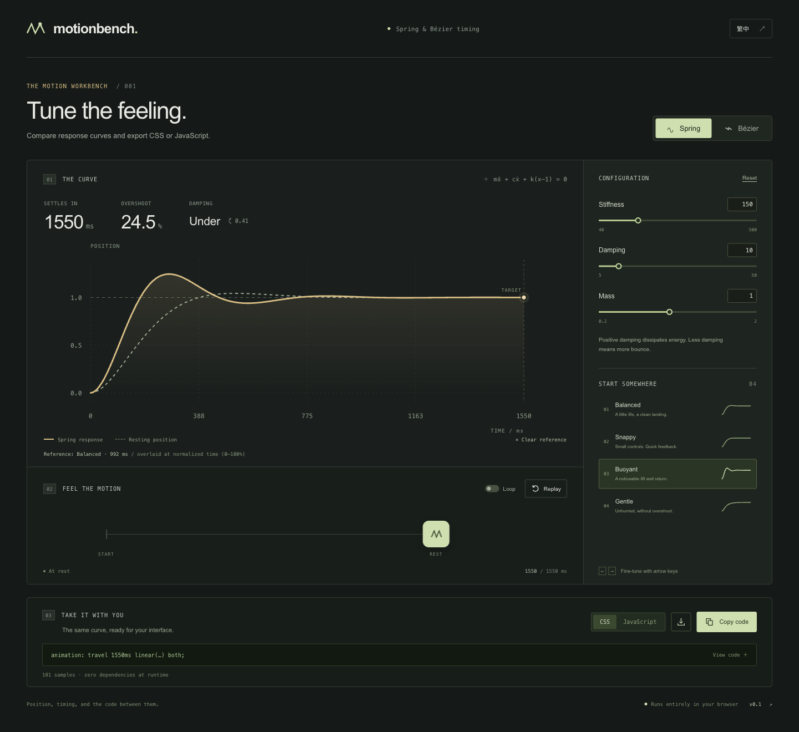

# Motionbench

A browser workbench for tuning spring and cubic Bézier motion. Change a parameter, inspect the response, and export the same motion as CSS or JavaScript.



**[Open the workbench](https://miiduoa.github.io/motionbench/)** · **[設計與工程筆記](docs/design.zh-TW.md)**

## Try it in a minute

1. Select **Buoyant**, then raise **Damping**. Watch the overshoot shrink and the landing change. Choose **Gentle** for an overdamped response.
2. Choose **Pin to compare**, then switch presets or move to **Bézier**. The dashed reference stays visible. Curves compare at normalized time; each duration remains visible.
3. Select **CSS** or **JavaScript** and open **View code**. Copy or download the result. CSS animates an element with `class="motion"`; JavaScript exports `playMotion(element, distance)` and returns its native `Animation`.

## What it does

- Analytic spring response across underdamped, critically damped, and overdamped systems; adjustable stiffness, damping, and mass.
- Cubic Bézier timing with adjustable control points and duration, including anticipation and overshoot.
- Response graph, duration and overshoot readouts, live playback, looping, four presets per model, and a pinned curve for comparison.
- Spring CSS uses `linear()` with 181 samples. Bézier CSS uses exact `cubic-bezier()`. JavaScript uses sampled Web Animations keyframes.
- Keyboard-accessible controls, editable numeric values with range validation, a reduced-motion mode, and English / Traditional Chinese UI.
- Local processing, no accounts, analytics, external fonts, or runtime network calls.

## Run

Node.js 24 or later; npm.

```sh
npm ci
npm run dev
npm run check
npm run build
```

`npm run check` runs TypeScript and the numerical/export test suite. `npm run preview` serves the production build. GitHub Pages deployment is configured in `.github/workflows/pages.yml`; the repository must have Pages configured to use GitHub Actions. The workflow deploys under `/motionbench/`.

## Model and boundaries

`src/motion.ts` is the independent numerical/export layer. `src/App.tsx` owns controls, curve comparison, playback, and file/clipboard interactions. `src/styles.css` provides the responsive instrument layout without a component framework.

Springs start at position `0` with zero velocity and target position `1`. Settling means position error below `0.001` and estimated speed below `0.01` for 200 ms, sampled at 120 Hz. Duration is capped at 12 seconds and the last exported sample is fixed to `1`; a capped curve is labeled in the UI. Spring curves and JavaScript exports are piecewise-linear approximations, not continuous physics engines. Overshoot is measured from those samples.

Pinned comparison aligns normalized time, not absolute milliseconds. It is a shape comparison, and does not simulate coupled objects or interrupted motion. Exported transforms replace the element's existing transform; use a wrapper if it already has rotation or scaling. CSS `linear()` needs a supporting browser; the JavaScript export is an alternative using the Web Animations API. Clipboard access depends on browser permissions and a secure context; downloading is available separately.

The tests cover all damping regimes, continuity around critical damping, numeric stability, increasing sample times, endpoint correctness, invalid inputs, duration caps, Bézier inversion, and executable JavaScript/CSS export contracts. Browser and assistive-technology coverage is separate from those unit tests.

## License

[MIT](LICENSE) © 2026 Miiduoa.
